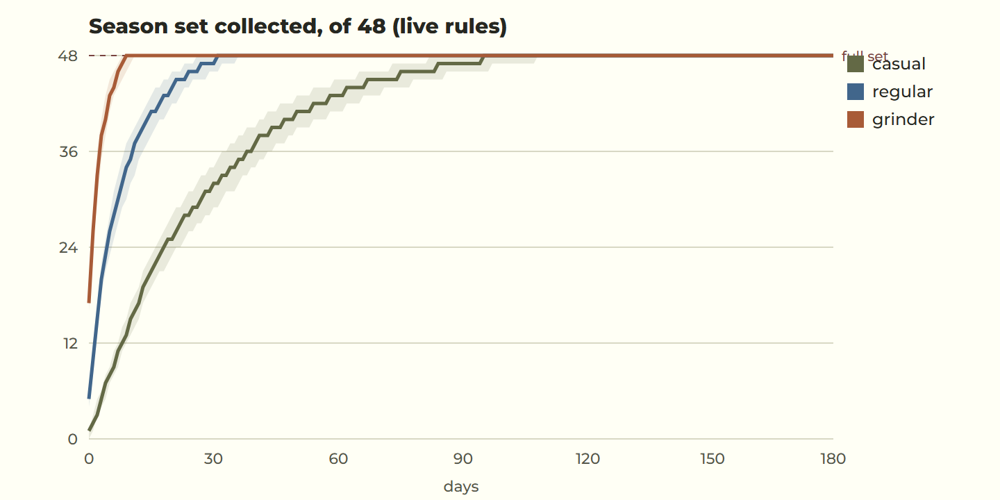
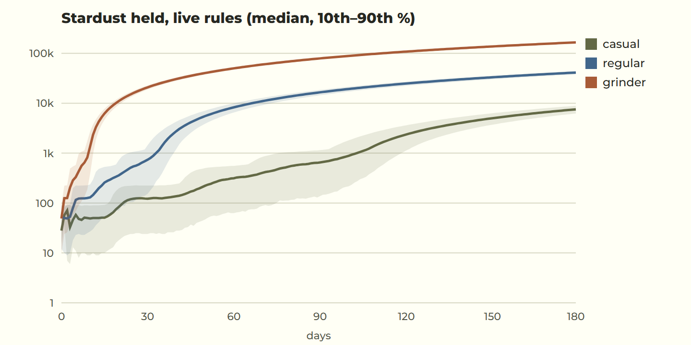
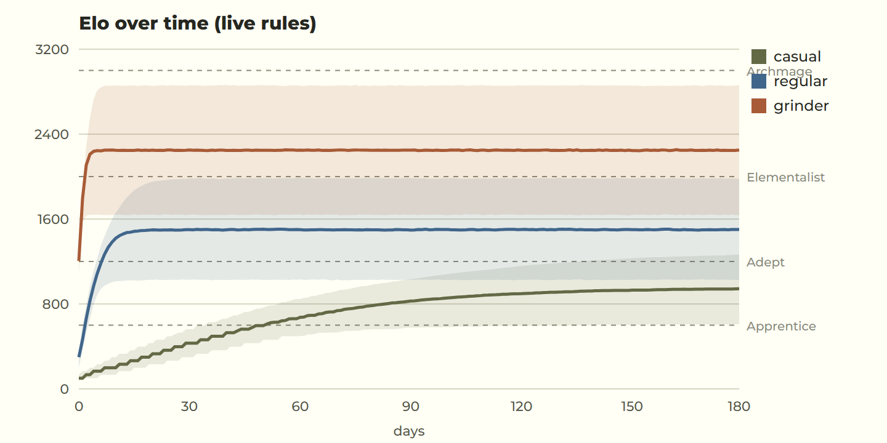
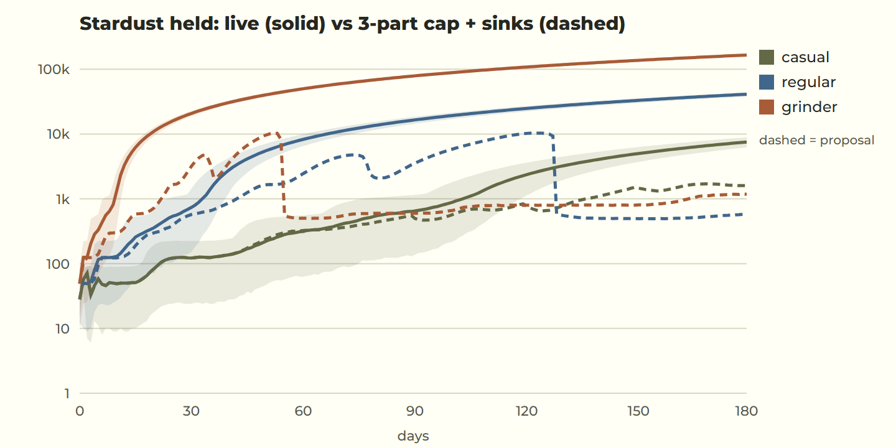

# Elomental audit: UX, progression, fun, economy (2026-10-20)

Audience: players aged 35–45, 5–15 minute sessions, who want clear, concise, calm and
satisfying play. Every finding is judged against them.

**Evidence:**
- **Code:** the code as deployed (`1029eff`) and the live database rules (`simple_economy`, `elo_curve`, `gentler_losses`).
- **Screenshots:** everything reviewed this session, on phone sizes, in both themes.
- **Simulations:** a Monte Carlo of 10,000 players per persona over 180 days, using the live rules (`scripts/audit-sim.mjs`, charts in `docs/audit/`).

**Limits:**
- I did not test on a real phone, or with real players.
- Player skill in the simulation is modelled, not measured.
- Claims marked *(unverified)* are judgement, not data.

---

## 1. Executive summary

**Top 5 problems**

1. **The collection is over too fast for engaged players, and then Stardust is worthless.**
   - Regulars finish the 48-part set on day 32 and grinders on day 10.
   - By day 180 they sit on 41k and 166k Stardust with nothing to buy (§3.2).
2. **Two of six Home tiles are dead ends.** Store and Leaderboard only show "opens soon". There's no profile page and no season screen, so the "flex" half of the loop doesn't exist yet.
3. **Promises the app doesn't keep yet:**
   - The Daily page and result say "Month complete. Avatar unlocked!", but nothing is granted.
   - The affinity screen says the winning side's "members earn the most", but there's no monthly settlement.
   - "Missed days can be restored with tokens" refers to a feature that doesn't exist.
4. **The result pop-up is crowded.** It can stack 12+ blocks: title, line, 3–4 stats, tips, promotion, Stardust, Crown, the part, a guarantee line, influence, an install note and a sign-up form, with two buttons at the bottom.
5. **Ranked stops moving after one to three weeks.** Elo locks onto each player's real skill, so a regular sits at Adept II from week 3 on, and the climb that drives "one more game" disappears (§3.4).

**Top 5 wins**

1. **The puzzle itself is excellent.** It's calm, fast, fully accessible (keyboard, screen reader, 200% text, high contrast) and well taught, with a 7-step skippable tutorial and hints that explain *why*.
2. **The parts loop is simple and honest.**
   - A visible "2 of 3" counter, published odds and guarantees, and duplicates that pay out.
   - No paid randomness, no timers and no energy.
3. **Every mode starts in 2 taps.** Clear, calm copy follows the brand voice.
4. **Casual pacing feels right.**
   - A part every session, the first Epic in about a week, the first Mythic in about 3 weeks.
   - The full set arrives around month 3, without grinding.
5. **Loss protection and gentle Elo losses** keep Ranked low-stress for this age group.

---

## 2. UX walkthrough (Part 1)

Taps are counted from Home. Severity: **C**ritical / **H**igh / **M**edium / **L**ow.

| Feature | Player goal | Taps | First-timer clarity | Friction / readability | Sev |
| --- | --- | --- | --- | --- | --- |
| Welcome splash | Get to the game | 0 (≈3s, tap skips) | Pretty, branded | Plays on **every** launch; 3s of 5-minute sessions | M |
| Tutorial (first game) | Learn the controls | 3 steps, skippable (2026-10-24: was 7; a hint's cost is told at the first one) | Clear and literal | Fine | L |
| Home / mode choice | Pick something to play | — | Tiles are clear | **Store and Leaderboard are dead ends** (toast). The avatar is the only way into the Forge, and nothing says so | H |
| Casual | Start a square | 2 (tile, Play) | Clear | "Clash a friend" and "Square code" are jargon to a newcomer | L |
| Ranked | Climb | 2 (tile, Start) | "Elo" isn't explained anywhere in plain words | Tier names (Adept II) shown without what's next or how far | M |
| Daily Square | Today's puzzle | 2 | Clear calendar | **"Avatar unlocked" is promised, nothing is given**; "tokens, coming soon" | H |
| Puzzle screen | Solve | — | Excellent | Well-sized board, numbers and contrast; skulls for mistakes are a little grim *(taste)* | L |
| Result + reveal | See what I earned, play again | 1 to next | Each block is clear on its own | **Too many blocks** (up to ~12) before the buttons; tips, guarantees, influence and install/sign-up all compete | H |
| Parts counter | Know what's next | — | "Next part: 2 of 3 squares" is perfect | Only shown on the result, nowhere persistent | M |
| Forge (inventory + crafting + avatar) | See, forge, wear parts | 1 (avatar) | Reads well once found | **Hard to find** (unlabelled avatar). 48 cards in a long scroll; rarity tags and states at 12px | H |
| Profile page | Show off | — | **Doesn't exist** | Avatar opens the Forge instead | H |
| Leaderboards | Compare | — | **Doesn't exist** (toast) | Affinity standings are only visible at the choice and as one line in the Forge | H |
| Seasons | Know the season | — | **No UI at all** | Season 0 runs to July 2027 but isn't mentioned anywhere | M |
| Affinity choice | Join a side | Auto, after 3rd solve | Clear, kind | **Takes over Home automatically**; promises rewards that don't exist yet | M |
| Setup | Adjust settings | 1 (Setup) | Grouped, literal | Good. Text size up to 200% is a strength for this audience | L |
| Store | — | — | Dead end | No currency to buy with yet, so rightly empty, but shouldn't be a tile | M |

**Readability:**
- Body text and contrast pass WCAG AA, and the automated contrast and axe checks are green.
- `--fs-caption` (12px) is used for meaningful information: rarity tags, part states and stat labels. For 35–45 eyes, 14px should be the floor for anything that carries meaning.

---

## 3. Simulation results (Part 2)

**Personas, from the brief:**

| Persona | Squares a day | Mix | Modelled skill |
| --- | --- | --- | --- |
| Casual | 3–5 | 80% Daily, 10% Ranked, rest mostly Medium Casual | Elo-equivalent ~900 ±300 |
| Regular | 10–15 | Daily, then half Ranked, half Casual Medium/Hard | ~1500 ±400 |
| Grinder | 40–50 | 85% Ranked | ~2300 ±500 |

**Modelling notes:**
- Mistakes and hints use typical rates, and wins earn the usual speed bonus.
- The rules are exactly the live ones: a part every 3rd rated solve, counted on the first 30 solves a day; odds 62/28/8/2%; Epic or better within 10 parts, Mythic within 25; duplicates convert to 20/50/120/300 Stardust; forging costs 100/250/600/1200 plus a Crown.

### 3.1 Drops and collection (days, median / worst 10%)

| | First Rare | First Epic | First Mythic (drop) | First forge | Set of 48 |
| --- | --- | --- | --- | --- | --- |
| Casual | 3 / 7 | 7 / 10 | 20 / 22 | 4 / 5 | **96 / 109** |
| Regular | 1 / 2 | 3 / 3 | 7 / 7 | 1 / 1 | **32 / 37** |
| Grinder | 1 / 1 | 1 / 1 | 3 / 3 | 1 / 1 | **10 / 12** |

**The guarantees work as intended.**
- The worst 10% wait only 2–3 days longer than the median for Epic or Mythic, because the guarantee caps bad luck tightly.
- In practice it reads as "Epic every few sessions" for a casual player, which is good and never feels rigged.

### 3.2 Stardust held (median, 10th–90th %)

| | Day 30 | Day 90 | Day 180 | Earned in 180 days |
| --- | --- | --- | --- | --- |
| Casual | 123 (24–224) | 639 (129–1,134) | **7,545** | 13,200 |
| Regular | 689 (140–1,191) | **16,289** | **41,207** | 47,913 |
| Grinder | **19,867** | **78,260** | **165,750** | 173,579 |

**Where Stardust stops meaning anything** (the set is done, and every new Stardust adds nothing):

| Persona | From |
| --- | --- |
| Grinder | about day 10 |
| Regular | about day 32 |
| Casual | about day 96 |

After that the "+20 Stardust" on every result is noise.

### 3.3 Is the pace right?

- **Casual: right.** A part every session, a full set in about 3 months, never starved, always something next. A 40-year-old playing 4 squares a day **will feel progress every session**.
- **Regular: too fast.** Done in a month, then 5 months with nothing to collect.
- **Grinder: far too fast.** Done in 10 days, and parts arrive about 10 a day.
- **The gap is fair in direction, too wide in size.** Grinders finish ~10× faster than casual players. Some lead is fine; at this size the collection stops meaning anything for anyone who plays a lot.

### 3.4 Elo and ranks (day reached, median / worst 10%; share who get there in 180 days)

| | Apprentice (600) | Adept (1200) | Elementalist (2000) | Archmage (3000) |
| --- | --- | --- | --- | --- |
| Casual | 51 / 78 (96%) | 131 / 167 (20%) | – | – |
| Regular | 3 / 4 (100%) | 7 / 12 (90%) | 20 / 72 (16%) | – |
| Grinder | 1 / 1 | 1 / 2 | 3 / 5 (81%) | 7 / 36 (10%) |

**Where players get stuck: at their own skill, by design.** Each Ranked square is rated at the player's Elo, so each game is close to 50/50 and Elo levels off at true skill:

| Persona | Elo reaches true skill in |
| --- | --- |
| Casual | about 4 months (they play little Ranked) |
| Regular | about 2–3 weeks |
| Grinder | about 1 week |

After that the rank badge never moves. That's honest, but it removes the climb: the motivation lies in **what the season adds on top** (proof wins, peak tier, season rewards), which isn't built yet.

---

## 4. Fun scorecard (Part 3)

| System | Score | Why |
| --- | --- | --- |
| Solving a square | 9/10 | Calm, precise and well taught; the core is genuinely good. |
| Daily Square | 7/10 | Lovely ritual and calendar; loses a point for the monthly avatar that never arrives. |
| Part drops | 7/10 | The "2 of 3" counter is a great "one more square" hook; the reveal is short and satisfying. |
| Forge | 5/10 | Simple rules, but hard to find and a long, flat list; nothing to do once complete. |
| Stardust | 3/10 | Meaningful for the first weeks, then pure noise for anyone above casual. |
| Ranked | 6/10 | Fair, protected, low-stress; but the badge stops moving and there's no season goal. |
| Affinities | 4/10 | A nice idea, but invisible after choosing, and the promised rewards don't exist yet. |
| Flex (profile, boards) | 1/10 | Doesn't exist yet: nowhere to show anything off. |

**"One more puzzle" moments:**
- the counter at 2 of 3;
- a guarantee about to land ("Epic or better within 2 parts");
- a promotion line.

**Where motivation drops:**
- the set is complete (day 10–96, by persona);
- Elo has levelled off (week 1–3);
- the 2 dead-end Home tiles.

**Dark patterns: none found.**
- No fake urgency, no paid randomness, no streak punishment, and the odds are published.
- The one risk is the **unkept promises** (§1, problem 3). For this audience, being told "unlocked" and getting nothing feels like being misled.

**Is competition stressful? No:**
- protection below 500;
- gentle losses (−15 to −20 around 500–1000);
- no visible losses on any profile.

**Does the profile read instantly?** There isn't one yet. The Home card (avatar, name, tier) is a good seed.

---

## 5. Prioritised improvements (Part 4)

Impact (I) and effort (E): **H**igh, **M**edium, **L**ow.

| # | Problem | Fix | I | E |
| --- | --- | --- | --- | --- |
| 1 | Unkept promises (§1.3) | **Say only what's true today**: soften the affinity and missed-day copy now; decide on the monthly Daily reward (see the open question below) | H | L |
| 2 | 12px text carries meaning | **Rarity tags, part states and the reveal's rarity at 14px minimum** | M | L |
| 3 | Forge is hard to find | **"Open the Forge" link right under a new part** on the result: the moment the player cares | H | L |
| 4 | Stardust becomes noise | **Two Stardust sinks** (Part 5): Polish and Name plates | H | M |
| 5 | Grinders finish 10× faster | **Parts count on the first 9 solves a day (3 parts a day)**, down from 30: grinder set day 10 → 21; casual and regular unchanged | M | L (one migration line) |
| 6 | Result pop-up crowded | **One reward strip**: "+20 Stardust · Next part 2/3" in one line; tips only after a loss of Elo; guarantee only when ≤3 away; install/sign-up only every 5th result | H | M |
| 7 | Dead-end tiles, no flex | **Leaderboard with the Affinities tab and a Profile page** (spec §5–6) before the Store; replace the Store tile with the Profile until there's something to sell | H | H |
| 8 | Ranked levels off | **Season goals on top of Elo**: "10 wins at your tier this season" proof wins and a season emblem (spec §1.3) | H | M |
| 9 | Splash every launch | Show the full welcome once a day; later launches go straight to Home | M | L |
| 10 | Affinity takes over Home | Ask in a calm card on Home ("Choose your side") instead of navigating away | M | L |

**Screen changes, before and after:**

- **#3 (result):**
  - Before: the part card, then the guarantee line, then the buttons.
  - After: the part card, then an "Open the Forge" link, then the guarantee line, then the buttons.
- **#6 (result):**
  - Before: Time, Mistakes, Hints, Elo, a tip, a promotion, then "+20 Stardust", then a Crown, then the part, the guarantee, influence, the install note, sign-up, and buttons.
  - After: Time · Mistakes · Elo in one block, then the part (when there is one), then one strip "✦ +20 · Next part 2 of 3", then the buttons.
- **#10 (Home):**
  - Before: Home turns away to a full page.
  - After: a one-line card under the profile ("Choose your side: Fire, Water, Earth or Air") that opens the same page.

**Economy change #5, proven** (10,000 players, with the sinks in place):

| Set of 48 (median) | Live | 3-part cap |
| --- | --- | --- |
| Casual | day 96 | day 110 (the sink "Mend a missed Daily" takes some Stardust) |
| Regular | day 32 | day 37 |
| Grinder | day 10 | day 21 |

---

## 6. Stardust sinks (Part 5)

### 6.1 The problem, measured

The surplus is the Stardust held once the set is complete (§3.2):

| | Day 30 | Day 90 | Day 180 |
| --- | --- | --- | --- |
| Casual | — (still collecting) | — (still collecting) | 7.5k |
| Regular | 0.7k (finishing) | 16k | 41k |
| Grinder | 20k | 78k | 166k |

### 6.2 Sink ideas

All of these are cosmetic, need no new currency, are optional, and give no edge in Ranked.

| Sink | One sentence | Cost and scaling | Best for | Where it shows |
| --- | --- | --- | --- | --- |
| **Polish** | "Polish a part you own to make it shine." | Levels I–V per part: 200 / 400 / 800 / 1,600 / 3,200 (6,200 a part; 298k for all 48) | Regular, grinder | A finish on the part (sheen at I, gilt rim at III, starlight at V), and "Polished 23" on the profile |
| **Name plate** | "Put your name on a plate." | Bronze 1,000 → Silver 2,500 → Gold 6,000 → Starlit 12,000 (21.5k total) | All | Behind the name on the profile and on every leaderboard row: the flex |
| **Mend a missed Daily** | "Fill in a day you missed this month." | 300, at most 3 a month | Casual | The calendar day turns solved (counts toward the month) |
| **Season stars** | "Light a star on this season's emblem." | 2,500 each, unlimited, after the set is polished to III | Grinder (long run) | A star count on the season emblem: "★ 14" |
| **Affinity banner** | "Add a thread to your side's banner." | 500 each, no limit; **no influence** | Fans of a side | The monthly banner lists the top weavers; your count on the profile |

### 6.3 With the sinks in place

Simulated with the 3-part daily cap and a simple spending habit: keep a reserve, save toward the next plate, polish with the rest, and mend missed Dailies.

| Stardust held | Day 30 | Day 90 | Day 180 | Bought by day 180 (median) |
| --- | --- | --- | --- | --- |
| Casual | 123 | 553 | 1,598 | 2 plates, 12 mends |
| Regular | 548 | 3,348 | 582 | 4 plates, 54 polish levels |
| Grinder | 2,619 | 599 | 1,177 | 4 plates, 151 of 240 polish levels |

**The surplus now stays between ~500 and ~3,300 for everyone.** That's enough that a new reward still means something, without being hoarded and without being drained. Grinders still have 89 polish levels and unlimited stars left for the next season.

### 6.4 Recommended first launch

1. **Name plates.** The single most visible flex, shown wherever the name appears. A clear goal ("Gold plate: 6,000"), and casual players reach Bronze and Silver in a season.
2. **Polish.** The big, scaling sink that keeps regulars' and grinders' Stardust meaningful for the whole season, and it shows on the avatar.
3. **Mend a missed Daily.** The casual player's sink: kind, cheap and capped. It also makes the "tokens, coming soon" line true, without a new currency.

Season stars and the affinity banner can wait for Season 1, when there's a season screen and a leaderboard to show them on.

---

## 7. Quick wins applied (Part 6)

These are committed locally, not pushed:

1. **Honest copy:**
   - The affinity screen no longer promises rewards that don't exist yet.
   - The missed-day line no longer mentions "tokens".
2. **14px floor:** rarity tags, part states and the reveal's rarity label move from 12px to 14px.
3. **"Open the Forge" on a new part:** a link under the reveal takes the player straight to the Forge.

## 8. Open question

**The monthly Daily avatar.** The Daily page promises an avatar for a full month, and nothing grants it. There are two options:

- (a) make it a real reward, for example a unique month part granted by the server (a migration);
- (b) reword it until it exists.

This needs your call. Option (a) is the better experience for this audience.
