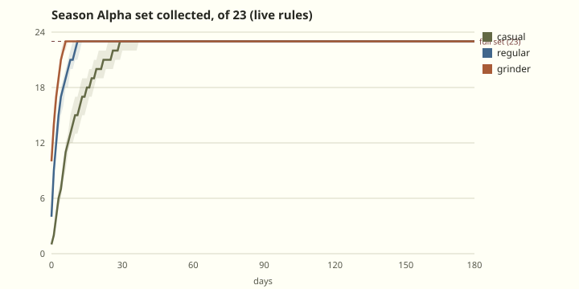
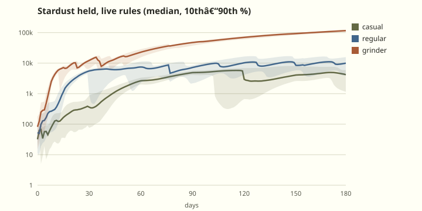
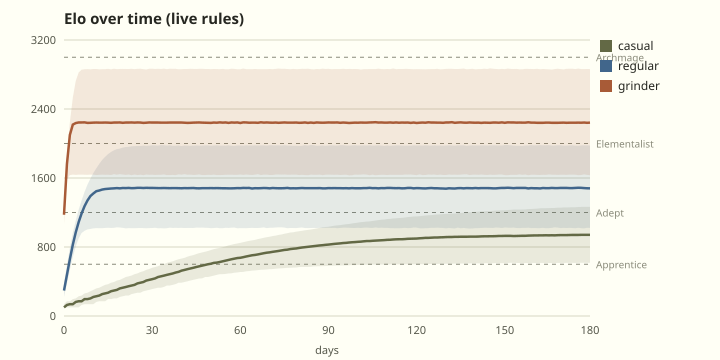
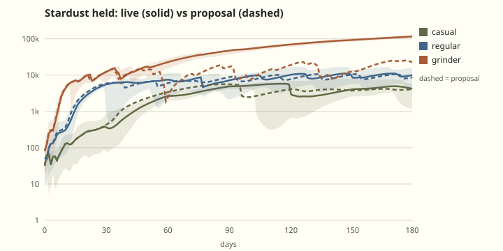
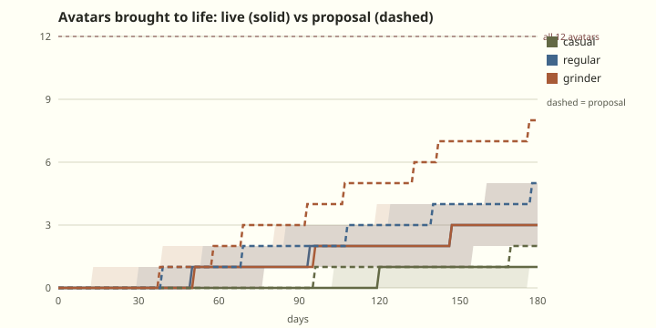

# Economy review: the live rules (game-economy-designer, 2026-10-20)

A read-only review of Elomental's live economy on branch `full-review`. No project files, migrations
or live data were changed. Every SQL below is a draft for the owner to apply after reading.

## What I looked at

**Code.** I read all 35 migrations in order and checked the live database against them: the list
of applied migrations matches, and the live `finish_game` is the one from
`20261020054008_dev_mode.sql` (9-a-day cap, 0.15% Spirit, dev-mode branches all present). I also
read the player copy (`packages/web/src/copy/en.ts`) and `screens/daily.ts`.

**Live data.** Read-only `SELECT`s against project `xekeiwaxxsmvalezgtyj`, aggregates only.
- 393 profiles; 16 players active in the last 7 days; 36 solved squares in total.
- 2 players have an affinity.
- 1 account has dev mode on.
- 0 months settled so far. The first settlement runs from pg_cron at 00:05 UTC on 1 November.

The live data is too thin to calibrate anything, so the pacing numbers come from the simulation.

**Simulation.** `scripts/audit-sim.mjs` was written for the 48-part set with Crowns. I copied it
to `..\icons\review-eco\eco-sim.mjs` and rewrote the rules to match
the live ones:

- 23-part set: 9 Common, 7 Rare, 6 Epic, 1 Mythic. Happy is free.
- Rarity odds 62/28/8/2. Epic or better guaranteed within 10 parts, Mythic within 25.
- A part every 3rd counted solve. Counted solves are the first 9 solved squares of a UTC day.
- The Spirit roll happens on counted solves: 0.15%, guaranteed at 700.
- Part pick: `ORDER BY rand() * weight DESC LIMIT 1`, modelled exactly. That's an argmax, not
  proportional sampling (see ECO-10).
- Duplicates pay 20/50/120/300. Forging costs 100/250/600/1200.
- Bring to life: 6000 Stardust + 1 Spirit, once per avatar, 12 avatars including Happy.
- Name plates 1000/2500/6000/12000, bought in order.
- Fill in a missed Daily: 300 Stardust, at most 3 a month.
- Monthly affinity win: +300 Stardust, modelled as a 1-in-4 chance.
- Elo: the live `elo_k` and `elo_loss_multiplier` curves, no loss below 500, target = own Elo,
  about +10% speed bonus, 25% hint cut.

I ran 10,000 players per persona over 180 days:

| Persona | Solves a day | Mix | Modelled skill |
| --- | --- | --- | --- |
| Casual | 3–5 | Daily first, then 90% Casual / 10% Ranked | 900 ± 300 |
| Regular | 10–15 | Daily, then half Ranked, half Casual | 1500 ± 400 |
| Grinder | 40–50 | Daily, then 85% Ranked | 2300 ± 500 |

**Spending habit in the simulation:**
1. Forge whatever is missing.
2. Fill in missed Dailies while the month can still be completed.
3. Bring an avatar to life as soon as a Spirit and 6000 Stardust are both in hand.
4. Buy plates only from Stardust above a 6000 "next life" reserve (1300 while still collecting).

**Where the supporting files are** (all in `docs/review/economy/`):
- the scripts: `eco-sim.mjs`, `table.mjs`, `charts.mjs`;
- the raw results: `sim-*.json`;
- every run side by side: `tables.txt`;
- the charts: `*.svg`.

To reproduce, run `node eco-sim.mjs live 10000`, then `node table.mjs live`.

**Where the docs and the code disagree:** listed in ECO-12. Everywhere in this review I go by the code.

---

## 1. The live economy in numbers (10,000 players each, 180 days)

Format: median / worst 10%. A percentage in brackets is the share of players who got there within
180 days.

### 1.1 Collection

| | First Rare | First Epic | First Mythic | Full set of 23 | Set owned on day 7 | Day 14 | Day 30 |
| --- | --- | --- | --- | --- | --- | --- | --- |
| Casual | 2 / 6 | 7 / 9 | 18 / 20 | **30 / 38** | 11 | 17 | 23 |
| Regular | 1 / 3 | 3 / 4 | 9 / 9 | **12 / 14** | 19 | 23 | 23 |
| Grinder | 1 / 3 | 3 / 4 | 9 / 9 | **7 / 8** | 23 | 23 | 23 |



- **Progress in the first 1–2 hours is good.** A regular's first session (9 solves) brings
  3 parts. The first Rare comes on day 1, the first Epic on day 3.
- **The 9-a-day cap works for fairness.** Regulars and grinders now get the same number of parts
  (540 in 180 days) and the same Spirits.
- **The set itself is gone in under two weeks for anyone above casual** (ECO-3).
- **Duplicates make up a large share of all Stardust earned:** 66% for casual players, 50% for
  regulars, 17% for grinders.

### 1.2 Spirits and animated avatars

| | First Spirit | First animated avatar | 2nd | 3rd | Spirits by day 180 (p10–p90) | Animated by day 180 |
| --- | --- | --- | --- | --- | --- | --- |
| Casual | 114 / 177 (99%) | 120 / 177 (99%) | 177 (8%) | – | 1 (1–2) | 1 |
| Regular | 51 / 78 | 51 / 78 | 95 / 156 | 130 / 170 (77%) | 3 (2–5) | 3 (2–5) |
| Grinder | 52 / 78 | 52 / 78 | 97 / 156 | 130 / 170 (76%) | 3 (2–5) | 3 (2–5) |

**Notes:**
- 29% of a regular's Spirits come from the 700 guarantee, not the roll.
- A casual player who plays on 70% of days gets a first animated avatar by day 180 only 42% of
  the time (median day 168).
- The owner's target is one animated avatar every 1–2 months for a regular. Today it's one every
  ~60 days, with the worst 10% waiting 78 days for the first.

### 1.3 Stardust held (median, 10th–90th percentile) and what it buys

| | Day 30 | Day 90 | Day 180 | Earned in 180 d | Plates by 180 | Bronze / Gold / top plate (day) | Fill-ins used |
| --- | --- | --- | --- | --- | --- | --- | --- |
| Casual | 386 (90–748) | 4,802 (4,100–5,523) | 4,181 (1,153–5,906) | 17,592 | 0 (0–2) | 119 (49%) / – / – | **15 (4,500 Stardust), completing 0.07 of 5 months** |
| Regular | 5,303 (4,443–6,048) | 6,946 (2,123–8,261) | 9,978 (4,065–15,804) | 55,890 | 4 (3–4) | 38 / 85 / 148 (69%) | 17, completing 1.2 of 5 months |
| Grinder | 11,485 (6,356–12,727) | **46,625** (36,537–49,055) | **116,262** (104,757–123,535) | 164,677 | 4 | 15 / 24 / 38 | 10 |



### 1.4 Elo pace

Days to each rank, median / worst 10% (share who get there):

| | Apprentice 600 | Adept 1200 | Elementalist 2000 | Archmage 3000 | Elo on day 7 / 30 / 180 |
| --- | --- | --- | --- | --- | --- |
| Casual | 49 / 75 (96%) | 130 / 165 (19%) | – | – | 171 / 419 / 941 |
| Regular | 3 / 4 | 7 / 11 (90%) | 20 / 64 (16%) | – | 1,190 / 1,485 / 1,480 |
| Grinder | 1 / 1 | 2 / 2 | 3 / 4 (81%) | 7 / 25 (10%) | 2,244 / 2,244 / 2,242 |



- **Elo levels off at real skill:** about day 20–30 for regulars and day 7 for grinders. After
  that, a player's Elo moves by a median of +1 (p10 −97, p90 +98) over the next 150 days.
- **Casual players end about 40 Elo above their modelled skill.** That comes from the loss
  protection below 500 and the half-size losses near 500. It's small, intended, and harmless.

---

## 2. Findings

Severity: **High**, **Medium**, **Low**.

### ECO-1 · High · Dev mode leaks into the live leaderboard, the affinity war, the numbered editions and the ledger

**Evidence (live data and code):**

1. **The leaderboard.** The one dev-mode account is in `private.lb` at Elo **3,589** after 13
   Ranked games. It's #1 on the global board; the best real player is on 329.
   - Dev mode sets Elo directly (`founder_mfa.sql:93-96`).
   - Dev-mode Ranked wins count as rated without the solve audit (`dev_mode.sql:195`).
   - `private.lb` only leaves out hidden, anonymous and restricted players
     (`leaderboard.sql:103-104`), so the account is listed. It also shows the Elomentalist plate,
     which dev mode set.
2. **The affinity war.** In dev mode, `solved_today := 0` (`dev_mode.sql:239`). That also lifts the
   influence cap, because the influence check is `solved_today < 25` (`dev_mode.sql:273`). Instant
   solves are accepted too (`dev_mode.sql:191`).
   - This month there are exactly two active members: Water 7 influence, Air 6.
   - The first ever settlement (1 November) can be decided by test play. It pays a dated badge and
     300 Stardust (`leaderboard.sql:475-500`), and the dev account itself would be paid.
3. **Numbered editions.** Mythic **Shocked No. 1**, the first of only 100 numbered editions, belongs
   to the dev-mode account. It was bought with dev-filled Stardust (`whole_avatars.sql:147`).
4. **The ledger.** `fill` sets 999,999 Stardust without writing a ledger row
   (`founder_mfa.sql:78-79`). Dev actions taken before `founder_mfa` aren't in `founder_log` at
   all: the log holds only `plate` and `forget_affinity`.
   - The dev account's balance is ~1,000,000 Stardust away from its ledger.

**Fix:**
- Mark any account that has ever switched dev mode on as a **test account**. This flag is sticky.
- Test accounts:
  - are hidden from the leaderboard and search (forced `lb_hidden`);
  - add no influence;
  - are not paid at settlement;
  - never take a numbered edition.
- Every `dev_action` that changes Stardust or Spirits writes a ledger row (`reason 'dev'`).
- Remove this month's test-account influence before 1 November.
- Recommended: the founder keeps a separate test account for dev mode, so their real account stays
  clean.

**Migration: yes** (draft §4.1). What changes for existing data:
- the founder's Shocked edition number is cleared, and the Mythic edition counter is recounted
  (No. 1 becomes free again);
- the founder's October influence row is deleted;
- no player's balance changes.

**Effort:** M.

### ECO-2 · High · The "month avatar" is promised but never granted, and casual players spend Stardust filling in days toward it

**Evidence:**
- **The promise.** The Daily page shows "October avatar", "Solve every square this month to unlock
  it." (`daily.ts:249-254`, `en.ts:115-117`). The result says "Month complete. Avatar unlocked!"
  (`en.ts:381`). Nothing on the server grants anything: `finish_game` only returns
  `monthComplete` (`dev_mode.sql:288-300`). The last audit flagged this (AUDIT.md §1.3), and it's
  still live.
- **The paid sink feeding into it.** "Fill in a missed Daily" (300 Stardust, 3 a month,
  `stardust_sinks.sql:69-91`) exists to complete the month.
- **The cost to a casual player.** If they fill in whenever the month still looks completable, they
  spend **4,500 Stardust in 180 days**. That's 26% of everything they earn. They complete only
  **0.07 of 5 months**, because a casual player misses about 6 days a month, so 3 fill-ins can't
  close the gap.
- **Even played perfectly**, a casual player completes 0.06 months (filling in only at month end).
  Regulars complete 1.2 of 5.

This breaks two of our rules: "never a tax on casual players", and losing must never take things
away. A paid sink toward a reward that doesn't exist is the clearest manipulation risk in the game
today.

**Fix:** make the reward real and reachable.
- **Grant it.** A dated badge, `daily-YYYY-MM` (the badge catalogue and showcase already exist),
  given the moment **20 days** of the month are solved or filled in.
  - The rule is `least(days_in_month, 20)`. Fill-ins still count, still cost 300, and are still
    capped at 3.
- **Copy** (BRAND_VOICE glossary):
  - "October badge"
  - "Solve 20 days this month to earn it."
  - "Month done. October badge earned."
- **Later:** a monthly Daily frame (source `'daily'` is already allowed on `parts`). That's when
  "avatar" can come back into the copy.

**Simulated with the rest of the proposal package (§3):**

| | Months earned out of 5 (live → proposal) | Fill-ins used |
| --- | --- | --- |
| Casual | 0.07 → **4.75** | 15 → 1 |
| Regular | 1.2 → **5** | 17 → 0 |
| Grinder | 4.5 → **5** | 10 → 0 |

**Migration: yes** (draft §4.2): `private.daily_month()`, called from `finish_game` and
`mend_daily`.
- Existing players: past months aren't granted after the fact. Optionally grant October 2026 to
  anyone at 20 or more on 1 November.
- Client: `en.ts:115-117`, `en.ts:381`, `daily.ts:249-254`, and `profile.ts:313` (the offline
  `done === days` check).

**Effort:** M.

### ECO-3 · High · The 23-part set is done in under two weeks, and Season Alpha runs another eight months

**Evidence:**
- **Set finish:** day **12** for regulars (worst 14), **7** for grinders, **30** for casual
  players (§1.1).
- **Season length:** Season Alpha ends **2027-07-01** (`simple_economy.sql:35`). That's 254 days
  after launch, so a regular has **~240 days with nothing left to collect**.
- **What a drop becomes:** from then on, every 3rd-solve reveal is "Already yours: +20 Stardust
  instead". Over 180 days a regular gets 540 parts, and all but 23 are duplicates. The part
  reveal, the best "one more square" hook in the game (AUDIT §4), goes empty in week 2.
- **The plan itself:** the Revision section puts seasons at Jan–Jun and Jul–Dec, so Season Alpha
  is already a long, irregular first season.

**Fix:** in order of preference.
- **(a) End Season Alpha on 2027-01-01** and open Season 1 (Jan–Jun 2027) with a new set. That
  matches the two-seasons-a-year rule. It needs new art by January.
- **(b) Stopgap, no new art: four Mythic frames**, one per element (`s0-frame-<element>-4`,
  Mythic, forge 1200). Frames come from the existing generator. Simulated (with §3):

  | Full set (median / worst 10%) | Live (23 parts) | +4 Mythic frames (27) |
  | --- | --- | --- |
  | Casual | 30 / 38 | 57 / 65 |
  | Regular | 12 / 14 | 22 / 25 |
  | Grinder | 7 / 8 | 11 / 12 |

  - Cost: a casual player's first animated avatar moves from day 97 to day 120 (Stardust goes
    to forging).
  - Benefit: it gives the Mythic guarantee four more chances to matter (ECO-8).
  - Copy fix needed: `en.ts:213` would name the fourth frame "IIII". Use Roman numerals properly
    ("IV").
- **(c)** The monthly Daily badge (ECO-2) adds one dated collectible every month for everyone.

**Migration: yes.**
- (a) `update public.seasons set ends_at = '2027-01-01 00:00+00' where id = 0;` plus a Season 1 row
  and parts, applied only once the art is ready. `private.current_season()` falls back to 0 when
  no row matches (`economy_affinity.sql:36-40`), so nothing breaks in the meantime.
- (b) Draft §4.3.
- Existing players keep everything. New parts arrive unowned, and nothing is vaulted until Season 1.

**Effort:** (b) S–M; (a) L (art).

### ECO-4 · Medium · Spirits: an invisible, very swingy wait, at the slow end of the owner's target

**Evidence:**
- **Regular pace today:** first animated avatar at day **51**, worst 10% at day **78** (2.6 months).
  3 (2–5) animated by day 180, and 23% of regulars don't reach a third.
- **The guarantee does a lot of the work.** At 0.15%, 35% of players reach the 700th counted solve
  without a Spirit (0.9985^700). So 29% of all Spirits are guarantee hits.
- **Casual players:** median 114, worst 177 days.
- **The guarantee is never shown.** Nothing in the web client reads `spirit_pity`. Parts get "Epic
  or better within N parts" (`en.ts:224`), but the headline long goal has no progress shown at
  all for up to 11 weeks.
- **The doc is too rosy.** `whole_avatars.sql:10-12` and PROGRESSION_DESIGN.md:40-41 promise "about
  one every 7–8 weeks". That's the median only.

**Fix:**
- **Spirit chance 0.15% → 0.20%; guarantee 700 → 500 counted solves.**
- **Show it:** "Spirit guaranteed within N squares" on the Profile and in the Forge's odds sheet.
  The owner can already read `profiles.spirit_pity` (RLS `core_schema.sql:27-28`), so this is
  client-only.
- **Odds copy** (`en.ts:260`): "The rarest drop: a 0.2% chance on each square that counts toward
  parts, and one is guaranteed within 500 of them."

**Simulated (Spirit change alone):**

| | First animated avatar (live → new) | Animated by day 180 | Spirits by day 180 |
| --- | --- | --- | --- |
| Regular | 51 / 78 → **40 / 56** | 3 (2–5) → **5 (3–6)** | 3 → 5 (p10 3, p90 7) |
| Grinder | 52 / 78 → 39 / 56 | | |
| Casual | 120 / 177 → 116 / 127 (now Stardust-bound, not Spirit-bound) | | Spirit 114 / 177 → **88 / 127** |

With the ECO-2 fill-in change too, a casual player's first animated avatar comes at **97 / 127**.

This lands a regular at one animated avatar every ~36 days, with the worst 10% under 2 months:
inside the owner's 1–2 month target. Lives stay a long goal: 12 avatars at that pace take about
14 months.

**Migration: yes** (two constants in `finish_game`, draft §4.2). Existing `spirit_pity` is kept.
Anyone already at 499 or more gets a Spirit on their next counted solve. Live max is tiny, so
it's harmless.

**Effort:** S.

### ECO-5 · Medium · Grinders' Stardust is a dead currency

**Evidence:**
- **The hoard:** grinders hold **46,625** Stardust on day 90 and **116,262** on day 180 (p10
  104,757), with nothing left to buy.
- **What runs out:** all four plates are done by day **38**, and the set by day 7.
- **What stays capped:** animated avatars are capped by Spirits at 3 (2–5) in 180 days, the same as
  a regular. That's fair, but it leaves nowhere for Stardust to go.
- **Regulars are fine:** 10k held on day 180, all plates, and still saving for the next life.

**Fix (needs owner approval: it's a new sink, not a new currency):**
- **"Call a Spirit": 15,000 Stardust, +5,000 for each one called this season.**
- One sentence for players: "Call a Spirit for Stardust; each one this season costs 5,000 more."
- It fits the sink rules:
  - optional;
  - scaling;
  - visible (an animated avatar shows on every leaderboard row);
  - no timer or monthly allowance, so nothing is lost by missing a month;
  - out of reach for casual players, so never a tax on them.
- It's refused when every owned avatar is already alive or has a Spirit waiting.

**Simulated (with the rest of §3):**

| | Stardust day 90 | Stardust day 180 | Animated by day 180 | Spirits called |
| --- | --- | --- | --- | --- |
| Grinder | 46,625 → **16,106** | 116,262 → **22,963** | 3 (2–5) → **8 (7–10)** | 3.35 |
| Regular | 6,946 → 8,642 | 9,978 → 8,601 | 3 → 5 (from ECO-4) | 0 |
| Casual | | | | 0 |




**Watch-outs:**
- Grinders will reach all 12 lives around day 220–250, near the end of Season Alpha. Season 1's
  new avatars reopen the sink.
- **Loot-box check (§8.3):** this sells certainty, not chance, so it's fine. But it does make
  Spirits obtainable for Stardust. If Stardust is ever sold for money, Spirits become purchasable
  too (deterministically). Flag that to counsel at the time.

**Migration: yes** (draft §4.4). It adds two columns; balances are untouched.

**Effort:** M (function plus a Forge card).

### ECO-6 · Medium · The affinity war rewards grinder density, pays one-solve members, and a tiny side is decided by one player

**Evidence:**
- **How it's settled:** standing = total influence ÷ members with 1+ solve (`leaderboard.sql:431-440`).
  The 300 Stardust and badge go to **every member with influence > 0** (`leaderboard.sql:487-498`).
- **The doc says otherwise:** §13.5 (PROGRESSION_DESIGN.md:937-945) requires 10+ contributing
  solves and gives every place something.
- **Monthly influence by persona,** using the influence table at `dev_mode.sql:274-279` and the
  25-a-day cap:

  | Persona | Influence a month |
  | --- | --- |
  | Casual | ≈ 350 |
  | Regular | ≈ 1,450 |
  | Grinder | ≈ 3,900 |

- **What that means:** one grinder counts as ~11 casual players in the average. Each casual member
  who plays once pulls their side's average down, which is quiet social pressure against casual
  players.
- **Now:** with two active members, one person decides the month (see ECO-1).

**Fix:**
- In the standing, count each member's influence **up to 300 a month** (about a casual player's
  month). The war then measures how many members show up, not hours played.
- A member counts as active, and gets paid, at **5 or more contributing solves** that month.
  That's lower than the doc's 10 (kinder to casual players), and the doc should be updated to 5.
- Keep 300 Stardust plus the dated badge.

**Migration: yes** (draft §4.1, `private.standings` and the settlement's `helped`). It changes no
balance. Apply it before 1 November so October settles under the new rule.

**Effort:** S.

### ECO-7 · Medium · The Season board ("Elo gained this season") ranks newcomers, not this season's play

**Evidence:**
- **How it ranks:** `season_gain = elo - elo_before(first rated game this season)`
  (`leaderboard.sql:95-99, 110`).
- **Newcomers dominate.** A new regular's first season gains a median of **1,380** (grinder
  2,142), because they climb from 100 to their skill.
- **Veterans sit at zero.** Simulated over day 30 → 180, a player already at their level moves a
  median of **+1** (p10 −97, p90 +98).
- **The result:** from Season 1 on, every returning player sits around 0 while fresh (or alt)
  accounts top the board. That rewards starting a new account, which is the wrong signal.

**Fix:**
- Rank the Season board by **best Elo reached this season**.
- Only players with **20 or more Ranked games this season** are listed.
- One line for players: "Your best Elo this season, from 20 Ranked games."

**Migration: yes.** Recreate `private.lb` with `season_best` in place of `season_gain`. Every
`lb_*` function that takes the `private.lb` row type needs recreating too. No balances change.

**Effort:** M.

### ECO-8 · Medium · The Mythic guarantee matters once; the Epic one stops mattering by day 10

**Evidence:**
- **Only one Mythic part exists** (Shocked). The first Mythic arrives on day 9 for everyone above
  casual. Median and worst 10% are both day 9, because the 25-part guarantee forces it.
- **After that, Mythics are just Stardust.** A regular then gets about 16 forced Mythics and **26
  Mythic duplicates** in 180 days, each just +300 Stardust. "Mythic guaranteed: your luck came due"
  becomes a fanfare for 300 Stardust.
- **The Epic guarantee:** 6 Epic parts, all owned by about day 10. Forced Epics are 4.3% of all
  parts.

**Fix:**
- The four Mythic frames from ECO-3(b). That gives five Mythic parts, so the guarantee lands on
  something new up to five times. Regular Mythic duplicates drop from 25.9 to 24.1 over 180 days;
  the bigger win is that Mythic moments mean something for about 3 weeks instead of 1.
- Honest copy: once a player owns every part of a rarity, the guarantee line reads "You own every
  Mythic part: the next one brings 300 Stardust."

**Migration:** with ECO-3(b). The copy part is client-only.

**Effort:** S.

### ECO-9 · Low · The ledger doesn't add up for 7 accounts

**Evidence:**
- **Accounts out:** 7 accounts whose Stardust ≠ the sum of their ledger rows, and 2 whose Spirits
  don't match.
- **Real players:** 6 of them, out by **326 Stardust** in total. That's Stardust earned before
  `economy_affinity` created the ledger.
- **The dev account:** out by about 1,000,000 (ECO-1).

**Fix:**
- Write one `opening` ledger row per mismatched account.
- Add dev ledger rows (ECO-1).
- Weekly health query: the count of mismatched accounts should stay 0.

**Migration: yes** (draft §4.1). It's ledger-only; no balance changes.

**Effort:** S.

### ECO-10 · Low · "Three times likelier" isn't what the code does, and the odds sheet doesn't say

**Evidence:**
- **The code:** `drop_part` picks with `ORDER BY rand() * (owned ? 1 : 3) * (own element ? 2 : 1)
  DESC LIMIT 1` (`dev_mode.sql:115-120`). That takes the highest score, which is not the same as
  sampling by weight.
- **The effect:** with one Common missing out of 9, the missing one wins **70%** of the time; true
  3× weighting would give 27%.
- **The copy:** the odds sheet says only "Most parts are ones you don't have yet" (`en.ts:254`).
  After day 12 that's false for regulars: every part is a duplicate.
- **Changing it to true weighting barely matters.** Simulated, the full set moves by 1–3 days
  (casual 30 → 33, regular 12 → 13), because forging fills the gaps either way.

**Fix:**
- Keep the behaviour; correct the comment and the design doc.
- Odds-sheet copy: "A part you don't have is much likelier than one you already own. Once you own
  them all, each part turns into Stardust."
- If exact 3× is preferred: `order by power(private.rand(), 1.0 / weight) desc`.

**Migration:** no (copy and doc only).

**Effort:** S.

### ECO-11 · Low · Unrated Ranked wins use up the daily 9 counted solves

**Evidence:**
- `solved_today` counts every won game today (`dev_mode.sql:237-238`), including Ranked wins marked
  `unchecked` or `copied`.
- Those wins pay only 1 Stardust and no part, but each still takes one of the 9 part and Spirit
  slots.
- Rare, but an honest player whose audit failed (for example, offline) loses part progress.

**Fix:** add `and not exists (select 1 from private.review_flags rf where rf.game_id = gg.id)` to
the count. There's an index on `review_flags(game_id)` already.

**Migration: yes** (in the draft `finish_game`, §4.2).

**Effort:** S.

### ECO-12 · Low · The docs and the code disagree

Go by the code. Each of these needs fixing in the docs (or, for the season rollover, in a
planned migration):

1. **PROGRESSION_DESIGN.md:16-23** (Revision) still says:
   - "Two currencies only: Stardust and Rusted Crowns";
   - "first 30 solves a day";
   - "+ a Rusted Crown";
   - "48 parts".

   Later bullets amend these, but the top of the live section is wrong. Rewrite the Revision as one
   current-state list.
2. **The plate name.** `stardust_sinks.sql:7` calls the top plate "Starlit"; the copy and doc say
   "Elomentalist". The copy is what players see, so it's correct.
3. **The Spirit pace.** "About one every 7–8 weeks" (whole_avatars and the doc) is the median; the
   worst 10% is 11 weeks (ECO-4).
4. **§8.2** "Every 8 weeks: new season" contradicts "two a year".
5. **§13.5** rewards (800/500/350/250 by place, components, the Victor crest) aren't what's built:
   the winner's members get 300 Stardust plus a badge (ECO-6).
6. **Season rollover.** Season 0 ends 2027-07-01, but `current_season()` silently stays on 0
   after that (`economy_affinity.sql:36-40`). There's no rollover without a migration, so plan
   one.

**Migration:** no (docs). **Effort:** S.

---

## 3. The proposed package, before and after

The package is ECO-2, ECO-4 and ECO-5 together: Spirit 0.2% with the guarantee at 500; Call a
Spirit at 15,000 + 5,000 per call; the Daily badge at 20 days, with fill-ins at month end. The run
tag is `proposal-scaling`. ECO-1, 6, 7, 9 and 11 change no pacing. ECO-3(b) is shown separately
in ECO-3.

| Median / worst 10% (day) | Casual live → new | Regular live → new | Grinder live → new |
| --- | --- | --- | --- |
| Full set | 30 / 38 → 30 / 36 | 12 / 14 → 12 / 14 | 7 / 8 → 7 / 8 |
| First Spirit | 114 / 177 → **88 / 127** | 51 / 78 → **40 / 56** | 52 / 78 → 39 / 56 |
| First animated avatar | 120 / 177 → **97 / 127** | 51 / 78 → **40 / 56** | 52 / 78 → 39 / 54 |
| Animated by day 180 | 1 → 2 (1–2) | 3 (2–5) → **5 (3–7)** | 3 (2–5) → **8 (7–10)** |
| Stardust day 30 | 386 → 363 | 5,303 → 5,708 | 11,485 → 11,698 |
| Stardust day 90 | 4,802 → 5,560 | 6,946 → 8,642 | 46,625 → **16,106** |
| Stardust day 180 | 4,181 → 4,023 | 9,978 → 8,601 | 116,262 → **22,963** |
| Plates by day 180 | 0 (0–2) → 1 (0–2) | 4 → 4 | 4 → 4 |
| Daily months earned (of 5) | 0.07 → **4.75** | 1.2 → 5 | 4.5 → 5 |
| Stardust on fill-ins | 4,500 → 300 | 5,100 → 0 | 3,000 → 0 |

**Sensitivity: a casual player who plays on 70% of days.**
- First animated avatar: day 168, reached by 42% within 180 days → day **136**, reached by **83%**.
- Daily months earned: 0 → 1.25 of 5.

---

## 4. Draft migrations (not applied: for the owner to review and apply)

### 4.1 `economy_review_integrity` (ECO-1, ECO-6, ECO-9)

```sql
-- Test accounts: any account dev mode has been switched on for. Kept off the boards, out of
-- the affinity war and the numbered editions, for good (the flag is sticky).
alter table public.profiles add column test_account boolean not null default false;
update public.profiles set test_account = true, lb_hidden = true where dev_mode;
-- (a founder account that used dev mode before and has it off now: set test_account by hand)

create or replace function public.dev_set_mode(p_on boolean) returns json
language plpgsql security definer set search_path = '' as $$
declare
  uid uuid := auth.uid();
begin
  if uid is null then raise exception 'not_signed_in'; end if;
  if not private.is_admin(uid) then raise exception 'not_admin'; end if;
  update public.profiles
    set dev_mode = coalesce(p_on, false),
        dev_next_drop = case when coalesce(p_on, false) then dev_next_drop end,
        dev_next_spirit = coalesce(p_on, false) and dev_next_spirit,
        test_account = test_account or coalesce(p_on, false),
        lb_hidden = lb_hidden or coalesce(p_on, false)
    where id = uid;
  insert into private.founder_log (founder_id, action) values (uid, case when coalesce(p_on, false) then 'dev_on' else 'dev_off' end);
  return json_build_object('devMode', coalesce(p_on, false));
end;
$$;

-- dev_action: as founder_mfa.sql:68-111, with ledger rows for fill / empty:
--   when 'fill' then
--     insert into private.ledger (player_id, reason, ref, stardust, spirits)
--       select uid, 'dev', 'fill', 999999 - stardust, 99 - spirits from public.profiles where id = uid;
--     update public.profiles set stardust = 999999, spirits = 99 where id = uid;
--   when 'empty' then
--     insert into private.ledger (player_id, reason, ref, stardust, spirits)
--       select uid, 'dev', 'empty', -stardust, -spirits from public.profiles where id = uid;
--     update public.profiles set stardust = 0, spirits = 0 where id = uid;

-- A test account can't un-hide itself.
create or replace function public.set_card_privacy(p_hidden boolean, p_stats boolean) returns void
language plpgsql security definer set search_path = '' as $$
begin
  if auth.uid() is null then raise exception 'not_signed_in'; end if;
  update public.profiles
    set lb_hidden = case when test_account then true else coalesce(p_hidden, lb_hidden) end,
        card_stats = coalesce(p_stats, card_stats)
    where id = auth.uid();
end;
$$;

-- Numbered editions: never for a test account; free the ones already taken.
create or replace function public.forge_part(p_part text) returns json
language plpgsql security definer set search_path = '' as $$
declare
  uid uuid := auth.uid();
  pt public.parts;
  cost integer;
  ed integer;
  v_test boolean;
begin
  if uid is null then raise exception 'not_signed_in'; end if;
  select * into pt from public.parts where id = p_part for update;
  if not found or pt.source <> 'craft' then raise exception 'not_forgeable'; end if;
  if pt.season_id is distinct from private.current_season() then raise exception 'vaulted'; end if;
  if exists (select 1 from public.player_parts where player_id = uid and part_id = p_part) then
    raise exception 'already_owned';
  end if;
  cost := private.forge_cost(pt.rarity);
  update public.profiles set stardust = stardust - cost where id = uid and stardust >= cost
    returning test_account into v_test;
  if not found then raise exception 'not_enough_stardust'; end if;
  if not v_test then
    if pt.rarity = 'mythic' and pt.editions_forged < 100 then ed := pt.editions_forged + 1; end if;
    update public.parts set editions_forged = editions_forged + 1 where id = p_part;
  end if;
  insert into public.player_parts (player_id, part_id, how, edition) values (uid, p_part, 'forge', ed);
  insert into private.ledger (player_id, reason, ref, stardust) values (uid, 'forge', p_part, -cost);
  return json_build_object('part', p_part, 'edition', ed);
end;
$$;
update public.player_parts pp set edition = null
  from public.profiles p where p.id = pp.player_id and p.test_account and pp.edition is not null;
update public.parts pt set editions_forged = (
  select count(*) from public.player_parts pp join public.profiles p on p.id = pp.player_id
  where pp.part_id = pt.id and pp.how = 'forge' and not p.test_account);

-- The affinity war: no test accounts; each member counts up to 300 a month; active = 5+ solves.
delete from public.affinity_months where player_id in (select id from public.profiles where test_account);

create or replace function private.standings(p_month date) returns table (affinity text, members integer, influence bigint, standing numeric)
language sql stable set search_path = '' as $$
  select e.affinity,
         coalesce(count(m.player_id) filter (where m.solves >= 5), 0)::integer,
         coalesce(sum(m.influence), 0)::bigint,
         round(coalesce(sum(least(m.influence, 300)) filter (where m.solves >= 5)::numeric
                        / nullif(count(m.player_id) filter (where m.solves >= 5), 0), 0), 2)
  from unnest(array['fire', 'water', 'earth', 'air']) as e (affinity)
  left join (select am.* from public.affinity_months am
             join public.profiles pr on pr.id = am.player_id and not pr.test_account
             where am.month = p_month) m on m.affinity = e.affinity
  group by e.affinity;
$$;
-- private.settle_faction_month: as leaderboard.sql:475-501, with `helped` as
--   select am.player_id from public.affinity_months am join public.profiles pr on pr.id = am.player_id
--   where am.month = p_month and am.affinity = win and am.solves >= 5 and not pr.test_account

-- Ledger: one opening row per account whose balance and ledger disagree (pre-ledger earnings).
insert into private.ledger (player_id, reason, ref, stardust, spirits)
select p.id, 'opening', 'reconcile 2026-10', p.stardust - coalesce(l.s, 0), p.spirits - coalesce(l.sp, 0)
from public.profiles p
left join (select player_id, sum(stardust) s, sum(spirits) sp from private.ledger group by 1) l on l.player_id = p.id
where p.stardust <> coalesce(l.s, 0) or p.spirits <> coalesce(l.sp, 0);

revoke execute on all functions in schema private from public, anon, authenticated;
```

**`finish_game` change for ECO-1.** The influence condition becomes
`if p.affinity is not null and solved_today < 25 and not p.test_account then`. This is part of the
full function in §4.2.

### 4.2 `economy_review_pace` (ECO-2, ECO-4, ECO-11, plus the ECO-1 line)

```sql
-- The Daily month: a dated badge at 20 days solved or filled in (or every day of a shorter month).
create function private.daily_month(p_player uuid, p_month date) returns json
language plpgsql security definer set search_path = '' as $$
declare
  days integer := extract(day from (p_month + interval '1 month - 1 day'))::integer;
  need integer := least(days, 20);
  done integer;
  v_badge text := 'daily-' || to_char(p_month, 'YYYY-MM');
  is_new boolean := false;
begin
  select count(*) into done from (
    select date_key from public.games
      where user_id = p_player and mode = 'daily' and won and date_key >= p_month and date_key < (p_month + interval '1 month')::date
    union
    select date_key from public.daily_mends
      where player_id = p_player and date_key >= p_month and date_key < (p_month + interval '1 month')::date
  ) d;
  if done >= need then
    insert into public.badges (id, source) values (v_badge, 'earned') on conflict do nothing;
    insert into public.player_badges (player_id, badge) values (p_player, v_badge) on conflict do nothing;
    is_new := found;
  end if;
  return json_build_object('done', done, 'days', days, 'need', need, 'monthComplete', done >= need,
                           'badge', v_badge, 'badgeNew', is_new);
end;
$$;

-- finish_game: as dev_mode.sql:138-306 with these four changes.
create or replace function public.finish_game(
  p_game_id uuid, p_won boolean, p_mistakes integer, p_hints integer, p_seconds integer, p_rating integer, p_grid text
) returns json
language plpgsql security definer set search_path = '' as $$
declare
  uid uuid := auth.uid();
  dev boolean := private.dev_on(auth.uid());
  g public.games;
  p public.profiles;
  wall integer;
  secs integer;
  min_secs integer;
  v_mistakes integer := least(greatest(coalesce(p_mistakes, 0), 0), 3);
  v_hints integer := least(greatest(coalesce(p_hints, 0), 0), 3);
  base integer;
  dust integer := 0;
  v_spirit boolean := false;
  delta integer;
  bonus numeric := 0;
  hint_cut numeric := 0;
  unrated text := null;
  elo_json json := null;
  daily_json json := null;
  drop_json json := null;
  progress_json json := null;
  influence integer := 0;
  solved_today integer;
begin
  if uid is null then raise exception 'not_signed_in'; end if;
  select * into g from public.games where id = p_game_id and user_id = uid for update;
  if not found then raise exception 'no_game'; end if;
  if g.finished_at is not null then raise exception 'already_finished'; end if;

  wall := extract(epoch from now() - g.started_at)::integer - g.paused_seconds
    - case when g.paused_at is null then 0 else least(extract(epoch from now() - g.paused_at)::integer, 300) end;
  wall := greatest(wall, 0);
  secs := case when g.mode in ('ranked', 'clash') then wall
               else least(greatest(coalesce(p_seconds, wall), 0), wall) end;

  if p_won then
    if not private.valid_solution(p_grid) then raise exception 'invalid_solution'; end if;
    min_secs := case g.difficulty when 'easy' then 15 when 'medium' then 30 else 45 end;
    if secs < min_secs and not dev then raise exception 'too_fast'; end if;
  end if;

  if g.mode = 'ranked' and p_won and not dev then
    if g.audit is null then unrated := 'unchecked';
    elsif coalesce((g.audit ->> 'copied')::boolean, true) or (g.audit ->> 'solution') is distinct from p_grid then unrated := 'copied';
    end if;
  end if;

  g.rating := private.clamp_rating(g.difficulty,
    coalesce(case when unrated is null then (g.audit ->> 'rating')::integer end, p_rating, g.rating),
    case when g.mode = 'ranked' then g.rating end);
  select * into p from public.profiles where id = uid for update;

  if p_won then
    base := case g.mode when 'daily' then 12 when 'ranked' then 20
              else case g.difficulty when 'easy' then 4 when 'medium' then 8 else 15 end end;
    dust := case when unrated is null then greatest(1, base - v_mistakes * 2 - v_hints) else 1 end;
    p.stardust := p.stardust + dust;
  end if;

  if g.mode = 'ranked' then
    g.elo_before := p.elo;
    delta := case when unrated is null then private.elo_delta(p.elo, g.rating, p_won, p.ranked_games) else 0 end;
    if p_won and delta > 0 then
      bonus := private.speed_bonus(secs, g.rating);
      hint_cut := least(1, v_hints * 0.25);
    end if;
    delta := round(delta * (1 + bonus) * (1 - hint_cut));
    p.elo := greatest(0, p.elo + delta);
    p.ranked_games := p.ranked_games + 1;
    g.elo_after := p.elo;
    elo_json := json_build_object('before', g.elo_before, 'after', g.elo_after,
      'protectedLoss', not p_won and delta = 0, 'bonus', bonus, 'hintCut', hint_cut, 'unrated', unrated);
    if unrated is not null then
      insert into private.review_flags (user_id, game_id, reason, audit) values (uid, g.id, unrated, g.audit);
    end if;
  end if;

  if p_won and unrated is null then
    -- CHANGE (ECO-11): unrated (flagged) wins don't use up the day's counted solves
    select count(*) into solved_today from public.games gg
      where gg.user_id = uid and gg.won and gg.finished_at >= date_trunc('day', now()) and gg.id <> g.id
        and not exists (select 1 from private.review_flags rf where rf.game_id = gg.id);
    if dev then solved_today := 0; end if;
    if solved_today < 9 then
      p.spirit_pity := p.spirit_pity + 1;
      -- CHANGE (ECO-4): 0.2%, guaranteed within 500 (was 0.15%, 700)
      if p.spirit_pity >= 500 or private.rand() < 0.002 or (dev and p.dev_next_spirit) then
        v_spirit := true;
        p.spirits := p.spirits + 1;
        p.spirit_pity := 0;
        p.dev_next_spirit := false;
      end if;
    end if;
  end if;

  update public.profiles
    set elo = p.elo, ranked_games = p.ranked_games, stardust = p.stardust, spirits = p.spirits, spirit_pity = p.spirit_pity,
        dev_next_spirit = p.dev_next_spirit
    where id = uid;
  update public.games
    set finished_at = now(), won = p_won, seconds = secs, mistakes = v_mistakes, hints = v_hints,
        rating = g.rating, elo_before = g.elo_before, elo_after = g.elo_after, stardust = dust, spirit = v_spirit,
        paused_at = null
    where id = g.id;
  if dust <> 0 or v_spirit then
    insert into private.ledger (player_id, reason, ref, stardust, spirits)
      values (uid, 'solve', g.id::text, dust, case when v_spirit then 1 else 0 end);
  end if;

  if p_won and unrated is null then
    if solved_today < 9 then
      update public.profiles set part_progress = (part_progress + 1) % 3 where id = uid
        returning part_progress into p.part_progress;
      if p.part_progress = 0 then drop_json := private.drop_part(uid, g.id); end if;
      progress_json := json_build_object('count', p.part_progress, 'every', 3);
    end if;

    -- CHANGE (ECO-1): test accounts add no influence
    if p.affinity is not null and solved_today < 25 and not p.test_account then
      influence := case g.mode
          when 'daily' then 4
          when 'ranked' then 3 + least(3, g.rating / 1000)
          when 'clash' then 3
          else case g.difficulty when 'easy' then 1 when 'medium' then 2 else 3 end
        end + case when v_mistakes = 0 and v_hints = 0 then 1 else 0 end;
      insert into public.affinity_months (month, player_id, affinity, influence, solves)
        values (date_trunc('month', now())::date, uid, p.affinity, influence, 1)
      on conflict (month, player_id, affinity) do update
        set influence = public.affinity_months.influence + excluded.influence,
            solves = public.affinity_months.solves + 1;
    end if;
  end if;

  -- CHANGE (ECO-2): the month's badge at 20 days
  if g.mode = 'daily' then
    daily_json := private.daily_month(uid, date_trunc('month', g.date_key)::date);
  end if;

  return json_build_object('seconds', secs, 'dust', dust, 'spirit', v_spirit, 'elo', elo_json, 'daily', daily_json,
    'drop', drop_json, 'progress', progress_json,
    'influence', case when influence > 0 then json_build_object('affinity', p.affinity, 'amount', influence) end);
end;
$$;

-- mend_daily: as stardust_sinks.sql:69-91, ending with
--   return json_build_object('date', p_date, 'left', 2 - used,
--     'daily', private.daily_month(uid, month_start));

revoke execute on all functions in schema private from public, anon, authenticated;
```

**Client changes that go with it:**
- `en.ts`:
  - 115-117 and 381: the badge wording (ECO-2);
  - 260: the Spirit odds;
  - a new "Spirit guaranteed within N squares" line (ECO-4).
- `daily.ts:249-254`: show `need` (20), not `days`.
- `profile.ts:313`: the offline check `done === days` becomes `done >= Math.min(days, 20)`.
- `supabase/tests/economy.mjs` has two assertions that change:
  - "the 700th counted solve brings a Spirit" becomes 500;
  - add "the 20th Daily of a month gives the dated badge, once".

### 4.3 `season_alpha_mythic_frames` (ECO-3b, ECO-8)

```sql
insert into public.parts (id, slot, element, rarity, season_id, source)
select 's0-frame-' || e || '-4', 'frame', e, 'mythic', 0, 'craft'
from unnest(array['fire', 'water', 'earth', 'air']) as e
on conflict (id) do nothing;
```

**Client:** frame art for `-4` from the frame generator, and `forge.part()` naming: "IV", not "IIII".
Existing players own none of the new frames. The set's "n of 23" becomes "n of 27".

### 4.4 `call_a_spirit` (ECO-5; needs the owner's yes)

```sql
alter table public.profiles
  add column spirits_called smallint not null default 0,
  add column spirits_called_season smallint;

-- Call a Spirit for Stardust: 15,000, then 5,000 more for each one called this season.
create function public.call_spirit() returns json
language plpgsql security definer set search_path = '' as $$
declare
  uid uuid := auth.uid();
  season smallint := private.current_season();
  p public.profiles;
  n integer;
  cost integer;
  avatars integer;
  alive integer;
begin
  if uid is null then raise exception 'not_signed_in'; end if;
  select * into p from public.profiles where id = uid for update;
  -- only while an owned avatar still has no Spirit to wake it (Happy counts)
  select 1 + count(*) into avatars from public.player_parts pp join public.parts pt on pt.id = pp.part_id
    where pp.player_id = uid and pt.slot = 'avatar' and pt.source <> 'starter';
  select count(*) into alive from public.player_parts pp join public.parts pt on pt.id = pp.part_id
    where pp.player_id = uid and pt.slot = 'avatar' and pp.polish = 1;
  if alive + p.spirits >= avatars then raise exception 'no_avatar_to_wake'; end if;
  n := case when p.spirits_called_season = season then p.spirits_called else 0 end;
  cost := 15000 + 5000 * n;
  update public.profiles
    set stardust = stardust - cost, spirits = spirits + 1, spirits_called = n + 1, spirits_called_season = season
    where id = uid and stardust >= cost;
  if not found then raise exception 'not_enough_stardust'; end if;
  insert into private.ledger (player_id, reason, ref, stardust, spirits) values (uid, 'call_spirit', season::text, -cost, 1);
  return json_build_object('spirits', p.spirits + 1, 'cost', cost, 'next', cost + 5000);
end;
$$;
revoke execute on function public.call_spirit() from public, anon;
grant execute on function public.call_spirit() to authenticated;
```

### 4.5 Season board (ECO-7, sketch)

Recreate `private.lb`, replacing `season_gain` with:

```sql
season_best = (select max(g.elo_after) from public.games g
               where g.user_id = p.id and g.mode = 'ranked'
                 and g.finished_at >= (select starts_at from season) and g.elo_after is not null),
season_games = (select count(*) from public.games g
                where g.user_id = p.id and g.mode = 'ranked'
                  and g.finished_at >= (select starts_at from season))
```

Then set `season_rank = rank() over (order by season_best desc)` where `season_games >= 20`.
Recreate `lb_row`, `lb_range`, `lb_place` and `lb_me`, which depend on the row type.

---

## 5. What's working (keep it)

- **The first session pays.** 3 parts from the first 9 solves, a Rare on day 1–2 and an Epic by
  day 3–7, for every persona.
- **The daily cap of 9 is fair.** Regulars and grinders get identical parts and Spirits. Grinders
  only earn more Stardust.
- **Clean on our core rules:** no energy, no streak that takes anything away, no paid randomness,
  and no item ever lost. The part guarantees are shown and they hold (the DB test confirms the
  longest waits are 9 and 24).
- **Bring to life is the right long goal.** It's one sentence, once per avatar, and visible on
  every leaderboard row. ECO-4 and ECO-5 only fix its pace.

## 6. Weekly health checks (aggregates, read-only)

1. **Median Stardust by account age,** in weeks 1 / 4 / 12. This flags hoarding.
2. **Ledger mismatches.** The count of accounts whose Stardust ≠ the sum of their ledger rows
   should be 0.
3. **Spirits:** how many come from the guarantee versus the roll, and the median `spirit_pity` of
   players who have none yet.
4. **The affinity war:** active members per affinity (5+ solves), and the share of influence from
   the top 10% of members.
5. **Test accounts:** none of them in `private.lb`, `affinity_months` or numbered editions.
